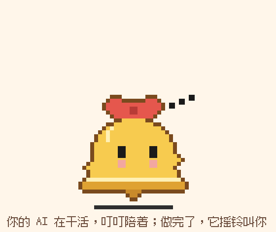
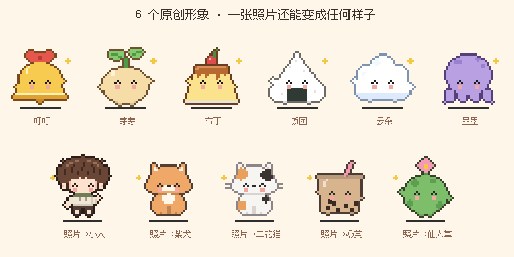
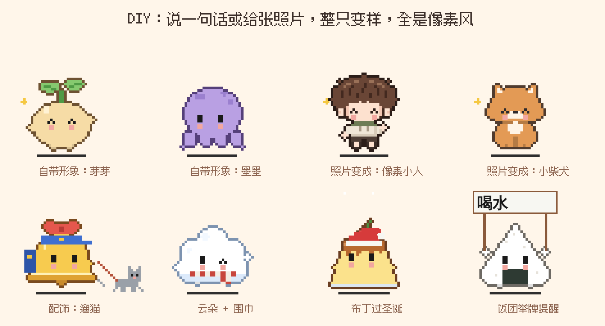
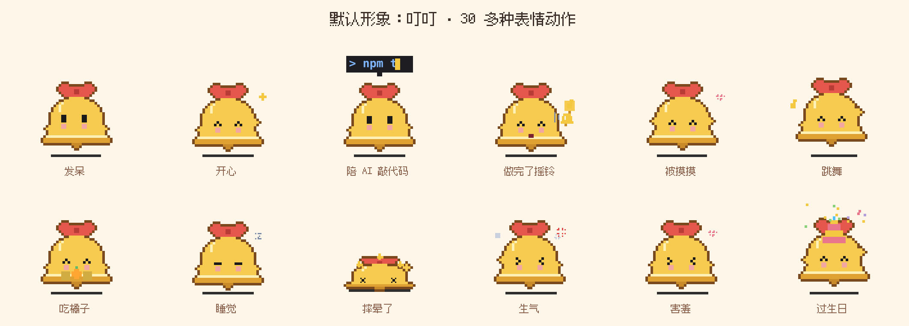

<p align="center">
  
</p>

<h1 align="center">叮叮 · AI 像素桌宠</h1>

<p align="center">
  <b>别再盯着 AI 等它写完了。</b><br>
  它在干活，叮叮在你桌面上陪着；它一做完，叮叮就摇铃喊你。
</p>

<p align="center">
  
  
  
  
</p>

---

## 为什么你会想要一只叮叮

- 🔔 **哪个 AI 做完了，它都知道。** Claude、ChatGPT、DeepSeek、Kimi、豆包、Cursor、WorkBuddy……任务一完成，叮叮举起小铃铛：「叮！Claude 的任务做完啦」。你去泡杯茶、刷会儿手机都行，不用守着屏幕。
- 💬 **像朋友，不像客服。** 闲聊就回一两句，正经问题才说长；会接住你的情绪，会吐槽，会记得你说过的事，还会不定时主动来找你聊天。
- 🛠️ **真的能帮你动手。** 清理电脑垃圾、修打不开的软件、查磁盘空间，直接跟它说就行。每一条命令都先弹窗给你看，你点了头它才执行。
- 🧬 **会给自己长本事。** 想要它多一个功能？跟它说，它会读自己的代码、改好、编译检查，再重启生效。
- 📸 **一张照片，整只变样。** 发一张人的照片，它变成 Q 版像素小人；发你家的猫狗，它变成大头团子；发一杯奶茶、一盆仙人掌，它也能变成圆滚滚的小家伙。画风永远统一，永远可爱。
- 🪶 **零安装。** 不用装 Python、不用装 Node，下载解压，双击就跑。

<p align="center">
  
</p>

## 30 秒上手

**Windows**：按 `Win + R`，输入 `powershell` 回车，粘贴这一行再回车：

```powershell
irm https://raw.githubusercontent.com/cmj1184077234-sketch/pixel-ai-desk-pet/main/install.ps1 | iex
```

**Mac**（测试版）：打开「终端」，粘贴这一行再回车：

```bash
curl -fsSL https://raw.githubusercontent.com/cmj1184077234-sketch/pixel-ai-desk-pet/main/install-mac.sh | bash
```

装好后叮叮会自己跳出来。想让它陪你聊天：右键叮叮 →「AI 设置」，填一个 AI 的 key（DeepSeek 很便宜，几块钱能聊很久）。不填也能用，它自带一个离线小脑袋。

> 💡 也可以直接跟会操作电脑的 AI 说：**“帮我安装 GitHub 上的 cmj1184077234-sketch/pixel-ai-desk-pet 桌宠”**，它会照着这页说明装好。

---

## 详细介绍

### 1. 懂你的 AI
- 你在用 Claude、ChatGPT、DeepSeek、Kimi、豆包、Cursor 等 AI 时，它会进入「思考 / 敲代码」状态。
- 认得 WorkBuddy 这类没有「停止」按钮的智能体：看它是不是持续在忙（后台偶尔动一下不算）。
- AI 分好几步干活时，中间停顿不会误报，一闪而过的不算任务；真的做完了，它「叮」一声举起小铃铛，头顶写着是哪个 AI 做完了（比如「叮！Claude 的任务做完啦」）。你正看着那个 AI 的窗口时，它只轻轻说一声，不摇铃吵你。你一直没理它，就会再响一次「叮——当」，最后冒出对话框，直到你摸摸它。
- 有 AI 在工作时，电脑不会息屏。

### 2. 像朋友一样聊天
- 说话有长有短：闲聊就一两句，还会像发微信一样分几条发；问正经事才说长。
- 接上 AI 大脑后，它有自己的想法：记得你说过的事，会不定时主动找你聊天，每次说的都不一样。
- 帮你查资料：会上网搜、打开网页核对，回答时附上来源，查不到就直说。
- 能看懂你在聊天框里发的图片（截图、照片、报错），和你一起聊。
- 能看见别的 AI 在聊什么：让它「看看 Claude 刚才说了什么」，它会读那个窗口里的文字，跟你一起讨论、说说自己的看法。只在你让它看的时候才看。
- 共情：你累了、委屈了，它先接住你的情绪、站在你这边，不急着讲道理。
- 不接 AI 也能聊：自带离线小脑袋，能记住你的喜好和计划、听出心情、接着话头问，知识类问题会去网上搜。

### 3. 能帮你干活，还能自己升级
- 软件打不开、清理电脑垃圾、查磁盘空间……直接在聊天里跟它说。它会一步步检查、动手、再确认结果，告诉你腾出了多少空间。
- **每一条命令都会先弹窗给你看，你点「允许运行」才会执行**，默认按钮是「不要」。
- 你想要的功能它现在没有？跟它说，它会读自己的代码、一处处改好（每处改动都弹窗给你看，自动编译检查，通过才保存，旧版本自动备份），然后自己重启生效。改坏了右键「撤销最近一次自我升级」。

### 4. DIY 超聪明：整只都能变，全部是像素风
- 默认是**叮叮**：一只戴红蝴蝶结的小铃铛精，AI 干完活就是它在摇铃。还自带 5 个原创形象：豆子发芽的芽芽、焦糖布丁、饭团、云朵、小章鱼墨墨，右键「换形象」就能切。
- 想要它变成小狗、兔子、你家的猫……说一句话，或者发一张照片，它会**重新画出整只自己**，表情和动作照样全都有。
- 照片里是人：会变成统一风格的 Q 版像素小人（头发占头的三分之二、圆脸、耳朵、方形腮红），AI 只负责看出发型（乱发 / 短发 / 长直发 / 波波头 / 丸子头 / 卷发）和各处颜色，程序来画，所以每次都整齐可爱。
- 照片里是宠物：会变成正脸坐着的像素小动物（猫、垂耳狗、立耳狗、兔子、仓鼠、熊；纯色 / 虎斑 / 斑点 / 三花 / 奶牛纹），大圆脑袋配小团子身子，脸颊有方形腮红，猫还有细胡须。
- 照片里是别的东西（奶茶、仙人掌、青蛙、机器人、玩偶……）：AI 从 10 种可爱底座（圆团、豆子、方块、三角、水滴、云朵、铃铛、布丁、杯子、章鱼）里挑最像的一个，配上颜色、头顶的标志物（小叶子、蝴蝶结、樱桃、天线、耳朵、小角、小花、吸管、皇冠……）和身上的花纹，程序来画，千奇百怪的照片出来也都是统一的圆润可爱风。
- 照着照片变时，可以顺便写要求，比如「变成照片里这只猫」「只要它的颜色」「加上小翅膀」，以你的要求为准。
- 还能加配饰：遛猫、草帽、围巾……和形象叠在一起穿。
- 不管怎么 DIY，出来的都是像素画：形象和配饰都画在同一套像素网格上，颜色最多 10 种，程序还会自动描一圈边。
- 性格可以选：元气话痨、慵懒佛系、傲娇嘴硬、温柔治愈、好奇小学者，或者自己写一段。
- 名字、它怎么称呼你、它的自我介绍，都能在 `config.txt` 里改。



### 5. 活灵活现



- 30 多种表情和动作：开心、跳舞、吃橘子、睡觉、听歌、杂耍、小鸟来做客……
- 拖到哪就停在哪，可以趴在窗口顶上；往下一甩会摔晕。
- 节日自动换装，你的生日和它自己的生日都会庆祝。
- 番茄钟、到点举牌提醒、每天写小日记、亲密度越高越黏你。
- 所有声音都是现场合成的像素小音效（叮当、小脚嗒嗒、呼噜噜），没有人声。

## 安装

### Windows（10 / 11）

用的是系统自带的 PowerShell 和 .NET Framework，不用装别的东西。

- **一键安装**：运行上面「30 秒上手」里的那行命令，会装到「文档\DingDing」，并在桌面放一个「叮叮」快捷方式。以后再运行一次就是更新，你的设置和日记都会保留。
- **手动安装**：点这个页面上方绿色的 **Code → Download ZIP**，解压到任意文件夹，双击 **`启动桌宠.vbs`**。第一次启动要编译代码，大概等十几秒。

如果 Windows 提示「已保护你的电脑」，点「更多信息 → 仍要运行」。启动失败的话，原因会写在同文件夹的 `错误日志.txt` 里。

### Mac（macOS 12 及以上，测试版）

- **一键安装**：运行上面「30 秒上手」里的那行命令，会装到「应用程序」里并自动打开。
- **手动安装**：在 [Releases](https://github.com/cmj1184077234-sketch/pixel-ai-desk-pet/releases/tag/mac-test) 下载 `DingDing-mac.zip`，解压后**右键点 DingDing →「打开」**（直接双击会被系统拦下）。

装好后在「系统设置 → 隐私与安全性 → 辅助功能」里打开 DingDing，它才能发现 AI 做完了、摇铃叫你。

想开机自动启动：右键叮叮 → 开机自动启动。

## 接上 AI 大脑（可选）

右键桌宠 → **AI 设置**，选一个服务，填上 API key，点「测试一下」。

| 服务 | 格式 | 说明 |
| --- | --- | --- |
| Claude（Anthropic API） | Anthropic | 最聪明，自己就能看图。key 从 console.anthropic.com 获取 |
| DeepSeek | Anthropic 兼容接口 | 便宜好用；看图用它的 `deepseek-v4-flash-vision-exp`（选 DeepSeek 时自动填好） |
| 智谱 GLM-4-Flash | OpenAI 格式 | 有免费模型；看图用 `glm-4v-flash` |
| Ollama | Anthropic 兼容接口 | 装在自己电脑上运行，免费，需要电脑配置够用 |
| 其他 | Anthropic 或 OpenAI 格式 | 自己填地址和模型名 |

- 「看图模型」：聊天模型看不了图时，先用它把图片看懂，再交给聊天模型。留空表示聊天模型自己看。
- 默认开着「省 token 模式」：历史记录更短，只在需要时才带上工具，日常聊天花费很少。
- 请遵守各个 AI 服务的使用条款和所在地区的规定。

## 怎么 DIY 形象

**说一句话（要先接上 AI）**：右键 →「和叮叮聊天」，说「你变成一只小柴犬吧」「给你戴个草帽」。整只变样的会出现在右键「我的形象」里，配饰在「我的配饰」里，随时切换。

**发照片**：
- 右键 →「用照片给叮叮变装…」，选照片，再写一句想变成什么样（不写也行）。
- 看照片需要能识图的模型（比如 Claude）。只会处理文字的模型看不了图；没接 AI 时，发照片只会把身体换成照片的主色。

**自己画**（喜欢动手的可以试）：右键 →「我的形象」→「打开形象文件夹」，新建一个 `.json` 文件，重启后就会出现在菜单里：

```json
{
  "name": "小柴犬",
  "palette": { "b": "#E8A05C", "w": "#FFF4E4", "p": "#F3C9A6" },
  "rows": [ "……20 行，每行 28 个字符……" ]
}
```

- 画布 28 列 × 20 行，每个字符是一个像素，`.` 是透明；`palette` 里必须有 `b`（身体主色），最多 10 种颜色。
- 第 8–12 行、第 7–21 列（从 0 数）是脸，要填满颜色：眼睛、嘴巴、腮红由程序画，这样表情才能动。
- 不用画手、脚和描边，程序会自动加。
- 配饰放在「我的配饰」→「打开配饰文件夹」里，格式类似，可以参考聊天时它画出来的文件。

## 隐私和安全

- 所有数据只存在你自己的电脑上：设置和 API key 在 `config.txt`，记忆、日记、造型在本文件夹和 `%APPDATA%\PixelDeskPet`。
- `config.txt`、日记、记忆文件、升级备份已经写进 `.gitignore`。**如果你 fork 后改了代码再上传，也不会把 key 传上去**，但还是请上传前检查一下。
- 帮你在电脑上做事时，每条命令都要你确认。它被要求不删除个人文件、不关杀毒和防火墙、不从来路不明的地方下载软件。
- 只有接了 AI 后，聊天内容才会发送给你选的 AI 服务；让它看别的 AI 窗口时，读到的文字也会发给你选的 AI 服务。
- 自我升级改的是本文件夹 `src` 里的代码，改动前会给你看，旧版本备份在 `src_backups`。

## 它是怎么知道 AI 在工作的

它用 Windows 的 UI Automation 看 AI 应用窗口或浏览器标签页里有没有「停止生成」这类按钮：有就是在工作，按钮消失就是做完了。

- 已经实际测过：Claude 桌面版、DeepSeek 网页版。其他应用和网站按同样的方法识别，但界面改版后可能需要更新识别规则（在 `src/Pet.cs` 的 `AI_APPS` / `AI_SITES` 和停止按钮关键词里）。
- 命令行里的 AI（终端里跑的工具）目前识别不到。
- 如果某个按钮被误认成「在工作」，右键桌宠选「「X」其实没在工作」就会记住忽略它。

## 项目结构

```
desk-pet.ps1          启动脚本：编译 src 里的代码并运行（改了代码重启就会重新编译）
启动桌宠.vbs           双击运行，不弹黑窗口
config.example.txt    设置模板，第一次运行会复制成 config.txt
src/
  Pet.cs              窗口、物理、动作、绘制、AI 工作识别
  Features.cs         日常功能：提醒、番茄钟、天气、日记、聊天窗口、像素字体
  Agent.cs            AI 大脑：接口、工具、造型 DIY、性格、主动聊天
  Brain.cs            离线小脑袋
  Sound.cs            合成音效、做完后的摇铃流程
  Skin.cs             整体形象：像素图皮肤、自动描边、小手小脚
  Upgrade.cs          看别的 AI 窗口里的文字、自我升级
assets/               像素字体（Fusion Pixel）
docs/                 README 里的图片
skins/                自带的形象（芽芽、布丁、饭团、云朵、墨墨和几个像素小人）
```

代码是 C# 5 + WinForms，由 PowerShell 的 `Add-Type` 现场编译，所以不需要 Visual Studio。

## 遇到问题 / 想要新功能？

都在 Issues 反馈栏里写，分两类，选对的那个照着填就行：

- 🐞 **[反馈问题](https://github.com/cmj1184077234-sketch/pixel-ai-desk-pet/issues/new?template=bug.yml)**：哪里坏了、不对劲、AI 做完了没摇铃……看到了会尽快修好、更新版本。识别 AI 有问题时，附上右键「检测诊断」生成的「诊断结果.txt」会修得更快。
- 💡 **[新功能建议](https://github.com/cmj1184077234-sketch/pixel-ai-desk-pet/issues/new?template=idea.yml)**：希望叮叮学会什么新本事、加什么新动作新造型。

## 参与

欢迎提 Issue 和 Pull Request：新的表情动作、更多 AI 应用的识别规则、Bug 修复都可以。提交前请确认没有带上自己的 `config.txt` 和个人数据。

## 许可

- 代码：[MIT License](LICENSE)
- 像素字体：[Fusion Pixel Font](https://github.com/TakWolf/fusion-pixel-font)，作者 TakWolf，使用 [SIL Open Font License 1.1](assets/OFL.txt)
- 本项目是个人作品，和文中提到的任何 AI 公司或产品都没有关联；各产品名称归各自所有者所有。
